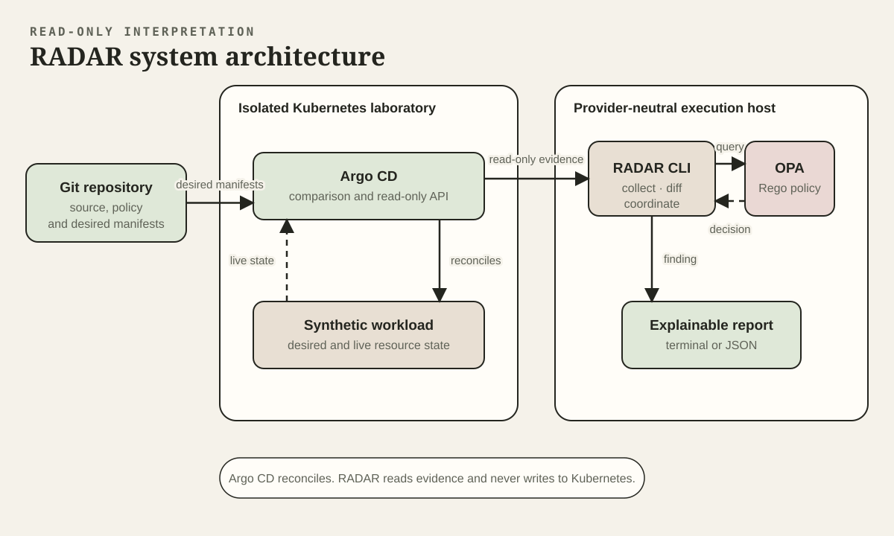
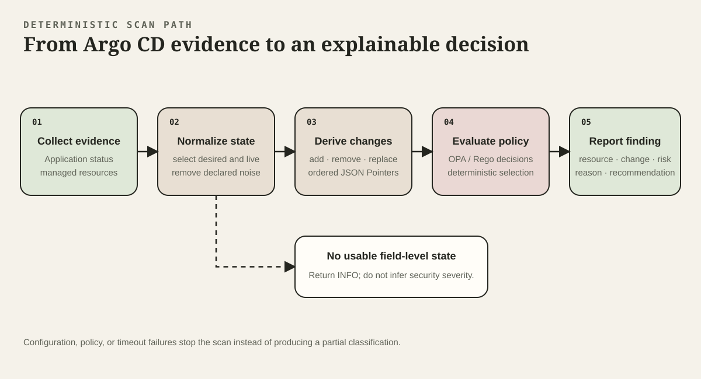
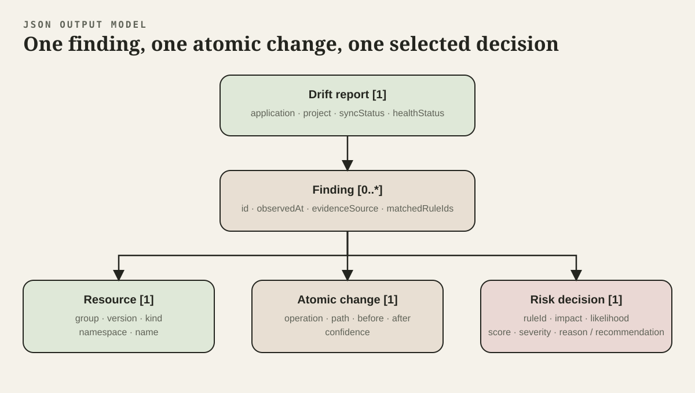

# Architecture

RADAR is a read-only interpretation layer for Argo CD drift evidence. Argo CD remains responsible for comparing desired and live state and reconciling Kubernetes resources. RADAR extracts atomic changes, evaluates them with OPA/Rego, and returns an explainable terminal or JSON report.

## System Boundary

Git supplies desired manifests to Argo CD. Kubernetes supplies the live resource state. During a live scan, RADAR does not read either source directly; it requests the resulting Application and managed-resource evidence from Argo CD through authenticated, read-only API calls.

The Go CLI is the collector and coordinator. It validates configuration, calls Argo CD, normalizes data, invokes OPA, selects a deterministic decision, and writes the report. The CLI and OPA can run on any compatible execution host; no named provider is required.

## Scan Pipeline

The selected extraction path is `GET /api/v1/applications/{name}/managed-resources`. RADAR compares Argo CD's `predictedLiveState` (normalized desired state) with `normalizedLiveState` (normalized observed state), using `targetState` and `liveState` only as fallbacks. The comparison produces atomic RFC 6902-style add, remove, and replace changes. Kubernetes-owned noise such as status, managed fields, resource versions, generations, UIDs, and timestamps is removed before comparison.

The Application endpoint supplies application and resource-level synchronization status. The managed-resources endpoint supplies the desired and live objects used for field-level comparison. The scan timeout covers the complete collection, evaluation, and reporting path.

When Argo CD returns no usable state or malformed state, RADAR keeps the resource at INFO rather than inventing a security classification. Resource additions and removals are represented as root-path add/remove changes.

Configuration, policy, and timeout failures stop the scan with an error. They do not produce a partial classification.

## Logical Drift Record

The normalized model separates evidence collection from policy and reporting. A report records the application, project, synchronization status, and health status. Each finding retains its stable identifier, observation time, evidence source, affected resource, atomic change, selected decision, and all matched rule identifiers.

The prototype has no application database. The diagram describes the JSON document that passes between components and is written as output; it does not imply persistent storage.

## Policy and Reporting

OPA/Rego is the policy engine. The scan command evaluates every normalized finding, selects the highest score, resolves equal scores by rule identifier, and retains all matched rule identifiers. The report contains the resource, operation, JSON Pointer path, before and after values, severity, score, reason, and recommendation.

Synthetic scan bundles validate the integrated extraction-to-report path. They are fixture-validated evidence, not live-cluster observations.

The risk matrix maps drift scenarios to CRITICAL, HIGH, MEDIUM, LOW, and INFO. INFO is used for resource-level OutOfSync findings where field-level change details are unavailable.

The CLI and JSON report are the primary interfaces. A dashboard is outside the research prototype scope.

## Controlled Laboratory

The controlled environment is a dedicated Minikube profile and Kubernetes context named `radar-lab`. Its binaries, Minikube home, kubeconfig, language caches, and generated credentials live below the ignored project-local `.radar-env` directory. Lab entry points refuse to operate when that environment is not active. The context server, CA and cluster UID must also match an identity recorded immediately after the profile is created.

Argo CD has self-heal disabled during observation and is exposed only through a process-owned, dynamically allocated `127.0.0.1` port. RADAR uses an API-token account and the browser demonstration uses a separate login account; both inherit the same read-only permissions for only the `radar/radar-lab` Application and project. Setup disables the bootstrap administrator after provisioning those credentials.

The scenario runner requires a clean source commit equal to the immutable Argo CD revision. It builds the scanner and policy from that commit, records their hashes, applies one synthetic mutation, and accepts a scan bundle only when Application snapshots bracketing managed-resource capture have the same resource version and frozen synchronization state. Reset uses the original revision, requires explicit success from every operation, and verifies the restored declared fields before another run.

The cross-cutting lab and evidence decisions are recorded in [ADR 0001](adr/0001-isolated-resettable-research-lab.md) and [ADR 0002](adr/0002-fail-closed-evidence-preparation.md).

Editable sources and export conventions are listed in the [diagram catalogue](../diagrams/README.md).
