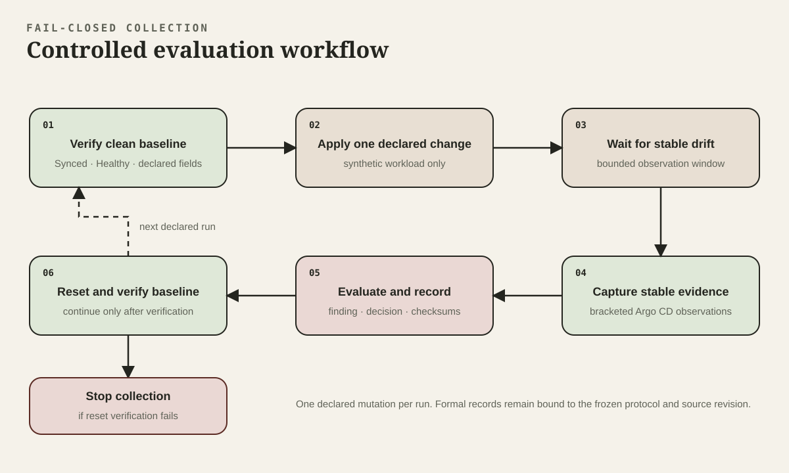

# Evidence and Results

RADAR separates development fixtures, controlled-lab observations, and formal evaluation. A file's presence in Git does not promote its evidence tier.

## Evidence Tiers

1. **Proposed** — described but not implemented.
2. **Implemented** — present in code.
3. **Fixture-validated** — exercised against stored synthetic input.
4. **Controlled-lab observed** — exercised against a real isolated Kubernetes and Argo CD testbed.
5. **Formally evaluated** — collected across all predeclared runs under a frozen protocol.

## Controlled Evaluation Workflow



Each declared run starts from a verified baseline and applies one synthetic change. Collection continues only after stable Argo CD evidence is captured. The runner records the finding and resets the workload, then verifies the declared baseline before another run. A failed reset stops collection.

## Formal Corpus

The authoritative formal collection is `research/evidence/formal-evaluation-v1/`. Its implementation freeze is immutable commit `7966d77366d5bcc99612adfa0c2c7a534e03eab9`. The corpus was later added to the repository without changing that executed source.

The protocol declared eight scenarios and ten repetitions per scenario:

| Scenario | Ground truth | Expected severity | Completed / declared |
| --- | --- | --- | ---: |
| RBAC wildcard | Security | CRITICAL | 10 / 10 |
| NetworkPolicy removal | Security | HIGH | 10 / 10 |
| Privileged container | Security | CRITICAL | 10 / 10 |
| `hostPath` addition | Security | HIGH | 10 / 10 |
| Service exposure | Security | HIGH | 10 / 10 |
| Unsafe image tag | Security | MEDIUM | 10 / 10 |
| Secret-reference change | Security | MEDIUM | 10 / 10 |
| Metadata-only change | Control | LOW | 10 / 10 |

MEDIUM or above was defined as security-positive before formal collection.

## Results

| Metric | Numerator / denominator | Result |
| --- | ---: | ---: |
| Completed and evaluable | 80 / 80 | 100% |
| Selected security scenarios detected | 70 / 70 | 100% |
| False negatives in selected security runs | 0 / 70 | 0% |
| Controls classified MEDIUM or above | 0 / 10 | 0% |
| Exact predeclared severity | 80 / 80 | 100% |
| Complete required explanations | 80 / 80 | 100% |

Median and nearest-rank p95 time to detect were both four seconds. Median processing latency was zero seconds and p95 was one second. Timestamps had one-second resolution, so zero seconds means observation and completion fell in the same recorded second; it does not prove instantaneous or subsecond processing.

These results measure deterministic repeatability for the declared synthetic inputs. They do not estimate accuracy for unseen drift, production prevalence, operator response, multi-cluster performance, or the independent correctness of the selected severity values.

## Reviewable Files

- `research/protocols/formal-evaluation-v1.json` — machine-readable declarations and ground truth.
- `research/evidence/formal-evaluation-v1/index.csv` — archive and run accounting.
- `research/evidence/formal-evaluation-v1/results/metrics.json` — derived metrics.
- `research/evidence/formal-evaluation-v1/results/run-accounting.csv` — one row per declared run.
- `research/evidence/formal-evaluation-v1/runs/` — sanitized reviewable run summaries.
- `research/evidence/formal-evaluation-v1/archives/` — immutable complete archives stored through Git LFS.

Each schema-version-4 run binds its declaration to source, scanner, policy, risk matrix, environment, protocol, exact scan input, result, timestamps, and verified reset.

## Verify the Corpus

Retrieve LFS objects:

```sh
git lfs pull
```

Verify the reviewable index and derived outputs:

```sh
cd research/evidence/formal-evaluation-v1
sha256sum --check index.csv.sha256
(cd results && sha256sum --check metrics.json.sha256)
(cd results && sha256sum --check run-accounting.csv.sha256)
```

Verify every immutable archive:

```sh
cd research/evidence/formal-evaluation-v1/archives
for checksum in *.tar.zst.sha256; do
  sha256sum --check "$checksum"
done
```

The reviewable summaries omit the large captured Argo CD responses. Extract a complete archive before running the semantic validator:

```sh
temporary_directory="$(mktemp --directory)"
trap 'rm -rf "$temporary_directory"' EXIT
(cd research/evidence/formal-evaluation-v1/archives && \
  sha256sum --check privileged-container-run-001.tar.zst.sha256)
tar --use-compress-program=unzstd \
  --extract \
  --file research/evidence/formal-evaluation-v1/archives/privileged-container-run-001.tar.zst \
  --directory "$temporary_directory"
python3 k8s-lab/scripts/validate-evidence.py \
  --protocol-file research/protocols/formal-evaluation-v1.json \
  "$temporary_directory/privileged-container-run-001"
```

Read `research/evidence/README.md` for the complete schema and storage contract. Read [Limitations](limitations.md) before reusing or quoting the results.
